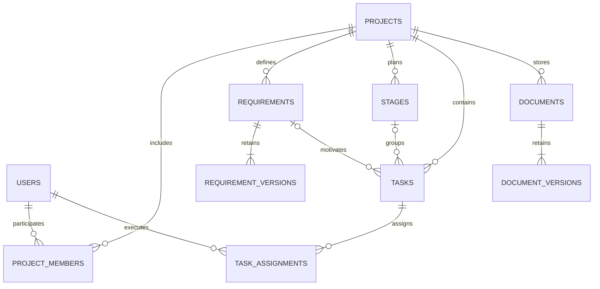

# Архитектура

Клиент — HTML/CSS/JavaScript без сборки и внешних CDN. Он обращается к JSON API того же источника. Backend — Python 3.11+, стандартная библиотека HTTP и отдельный слой бизнес-правил. Хранилище — SQLite либо PostgreSQL через psycopg 3. Настройки берутся из окружения.

| Файл | Ответственность |
| --- | --- |
| `static/app.js` | Навигация, формы, таблицы, доска, диалоги и клиент HTTP |
| `static/app.css` | Адаптивная вёрстка и оформление печати |
| `hydroflow/server.py` | HTTP-маршруты, JSON, сессии, CSRF, ограничения запросов |
| `hydroflow/services.py` | Авторизация операций, валидация, версии, назначения и отчёты |
| `hydroflow/db.py` | Подключения, параметризованные запросы, транзакции, миграция v1 |
| `hydroflow/security.py` | PBKDF2, проверка паролей, хеши токенов и время |
| `hydroflow/__main__.py` | Запуск, инициализация, демонстрационные данные, backup |

Каждый запрос API выполняется в транзакции. Ответ об успехе отправляется после commit. Исключение откатывает изменения. SQLite использует WAL и BEGIN IMMEDIATE; запись сериализуется. Требования и документы дополнительно защищены условным UPDATE по номеру версии. PostgreSQL не допускает перезапись уже изменённой версии: второй запрос получает HTTP 409.

## Основные связи

Комментарий содержит тип и ID целевого объекта; существование и принадлежность проекту проверяет сервис. Полиморфная ссылка комментария не имеет внешнего ключа к одной из трёх таблиц. Удаление объекта через API удаляет его комментарии в той же транзакции. `sessions` хранит хеш токена и срок действия; `audit_log` — автора, действие и объект. Внешние ключи прочих связей включены и в SQLite.

Файлы документов хранятся в БД в base64 и входят в снимки версий. Это упрощает перенос и резервное копирование учебной установки. Цена решения — увеличение размера примерно на треть и дублирование файла в редакциях документа. Для больших объёмов следует перейти к объектному хранилищу и потоковому скачиванию.

## Ограничения

Один процесс сервера; ограничитель попыток входа хранится в его памяти. Списки не имеют серверной пагинации. SQLite и HTTP-сервер стандартной библиотеки рассчитаны здесь на учебную установку; максимальное количество пользователей не измерялось. Схема мигрируется командой `init` или при запуске `serve`. Для обновлений схемы следует добавлять новые номера миграций, сохраняя применённую v1.
