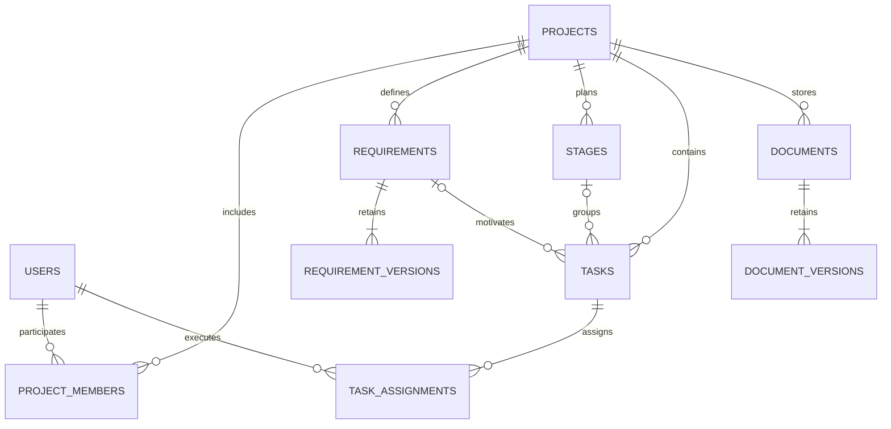

# Архитектура

Клиент — HTML/CSS/JavaScript без сборки и внешних CDN. Он обращается к JSON API того же источника. Backend — Python 3.11+, Flask factory с Blueprints, Waitress и отдельный слой бизнес-правил. Хранилище — SQLite либо PostgreSQL через psycopg 3. Настройки берутся из окружения.

| Файл | Ответственность |
| --- | --- |
| `static/app.js` | Формы, таблицы, доска, диалоги и клиент HTTP |
| `static/pages.js` | URL/history, меню, кабинет, обращения, справка |
| `hydroflow/web/` | Blueprints auth/projects/admin/account/pages; общая HTTP-граница |
| `templates/` | Jinja HTML-оболочка и страницы ошибок |
| `static/app.css` | Адаптивная вёрстка и оформление печати |
| `hydroflow/server.py` | Фабрика Flask, обработка ошибок, защитные заголовки, запуск Waitress |
| `hydroflow/services.py` | Авторизация операций, валидация, версии, назначения и отчёты |
| `hydroflow/db.py` | Подключения, параметризованные запросы, транзакции, миграции v1/v2 |
| `hydroflow/security.py` | PBKDF2, проверка паролей, хеши токенов и время |
| `hydroflow/__main__.py` | Запуск, инициализация, демонстрационные данные, backup |

Каждый запрос API выполняется в транзакции. Ответ об успехе отправляется после commit. Исключение откатывает изменения. SQLite использует WAL и BEGIN IMMEDIATE; запись сериализуется. Требования и документы дополнительно защищены условным UPDATE по номеру версии. PostgreSQL не допускает перезапись уже изменённой версии: второй запрос получает HTTP 409.

Origin и JSON проверяются до открытия транзакции: медленная передача тела не удерживает блокировку SQLite. В PostgreSQL изменяющие операции блокируют строку проекта (`FOR UPDATE`) до commit. Проверки участия, назначений, ссылок и удаления комментариев выполняются после этой блокировки; записи одного проекта сериализуются, разных проектов — независимо. Это сознательный компромисс для учебной нагрузки. Изменения требований и документов сохраняют дополнительную проверку версии.

Назначение блокирует строку пользователя в режиме `FOR SHARE`, вход и смена пароля — `FOR UPDATE`; конкурентный вход не должен создавать сессию на основе пароля, уже заменённого другой транзакцией. Ограничения БД откатывают всю операцию и отображаются как HTTP 409. Схема v1 не изменялась; v2 добавляет feedback и system_locks. См. data-model.md.

## Основные связи

Комментарий содержит тип и ID целевого объекта; существование и принадлежность проекту проверяет сервис. Полиморфная ссылка комментария не имеет внешнего ключа к одной из трёх таблиц. Удаление объекта через API удаляет его комментарии в той же транзакции. `sessions` хранит хеш токена и срок действия; `audit_log` — автора, действие и объект. Внешние ключи прочих связей включены и в SQLite.

Файлы документов хранятся в БД в base64 и входят в снимки версий. Это упрощает перенос и резервное копирование учебной установки. Цена решения — увеличение размера примерно на треть и дублирование файла в редакциях документа. Для больших объёмов следует перейти к объектному хранилищу и потоковому скачиванию.

## Ограничения

Один процесс сервера; ограничитель попыток входа хранится в его памяти. Списки не имеют серверной пагинации. SQLite рассчитан здесь на локальную учебную установку; Waitress обслуживает WSGI, для размещения предусмотрен PostgreSQL; максимальное количество пользователей не измерялось. Схема мигрируется командой `init` или при запуске `serve`. Для обновлений схемы следует добавлять новые номера миграций, сохраняя применённую v1.

## Flask и отдельные страницы

`create_app(config)` регистрирует пять Blueprints. HTML-маршруты проверяют сессию и роль до шаблона; API независимо повторяет авторизацию. JSON читается до транзакции, строгие проверки прежнего сервера сохранены. После commit Flask сериализует ответ. Исключения откатывают операцию; сообщения драйвера и содержимое обращений не выводятся клиенту/в общие логи.

Обращение блокирует строку автора для сериализации лимита и request_key; ответ администратора использует условный UPDATE по version. Изменение системных ролей сериализуется строкой system_locks с повторным чтением прав действующего ADMIN. Несколько процессов не делят ограничитель входа, поэтому конфигурация запуска использует один процесс.

Официальные основания: [фабрика Flask](https://flask.palletsprojects.com/en/stable/patterns/appfactories/), [Blueprints](https://flask.palletsprojects.com/en/stable/blueprints/), [Waitress](https://flask.palletsprojects.com/en/stable/deploying/waitress/). Старого HTTP handler под оболочкой Flask нет; make_server в тестах — Werkzeug WSGI fixture.
