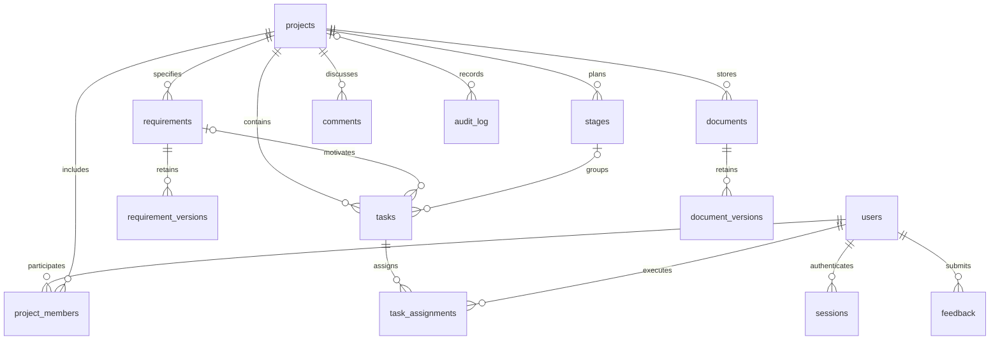

# Данные и миграции

Код DDL находится в `hydroflow/db.py`: неизменённый список `SCHEMA` (v1) и добавленный `SCHEMA_V2`. `schema_migrations` хранит применённые номера. SQLite использует внешние ключи и транзакцию `BEGIN IMMEDIATE`; PostgreSQL — BIGSERIAL/BIGINT и транзакционную DDL. Перед PostgreSQL-миграцией берётся advisory lock с ключом текущей схемы. Повторная и одновременная миграции проверены тестами.

V2 добавляет `feedback`: id, user_id (автор), subject (до 160), category (question/bug/suggestion), body (до 10000), status (new/work/closed), reply (до 10000), answered_by, request_key, version, created_at, updated_at. Автор/время задаются сервером. Внешние ключи связывают автора и ответившего с users; удаление пользователей через API не предусмотрено. UNIQUE(user_id,request_key) защищает повторную отправку; индексы — автор/дата и статус/id. Проверка текста/длины выполняется сервисом, категории/статусы дополнительно ограничены CHECK.

`system_locks` содержит строку `administrators`. Блокировка этой строки сериализует изменение системных ролей/активности и начальную подготовку хостинга. После блокировки повторно проверяется актуальная роль действующего администратора. Самостоятельная смена своей роли/активности запрещена. Два администратора не могут взаимно отключить последних активных администраторов.

Другие ограничения сохранены: уникальный код требования внутри проекта; версии требований/документов; внешние ключи связей задач; уникальные назначения; даты окончания не раньше начала. Ссылки между разными проектами проверяются сервисом под блокировкой проекта. Комментарии имеют полиморфную ссылку, поэтому их существование/проект проверяет сервис, а удаление комментариев вместе с объектом выполняется транзакционно.

Миграция v2 не меняет v1, не удаляет и не преобразует существующие строки. Регрессия `test_v1_upgrade_preserves_every_existing_table_and_attachment` сравнивает все 13 таблиц v1 до и после обновления, включая пользователей, связи, комментарии, историю и байты вложения; затем повторяет миграцию. Обновление рабочей установки всё равно начинается с резервной копии; инструкция — [эксплуатация](operations.md).
